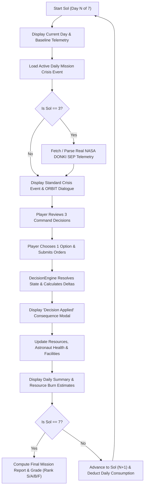
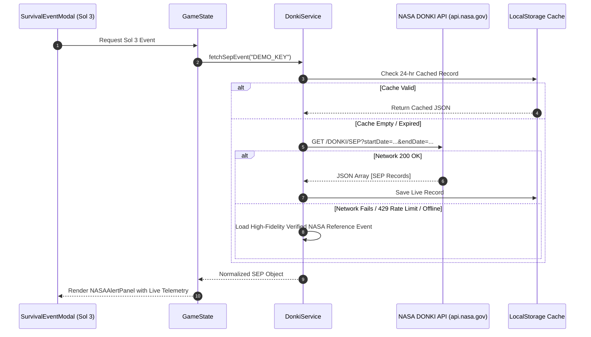

# LUNA: MISSION SURVIVAL
## Module 3 Technical Reference Manual: Survival Engine & NASA Data Integration

---

### Table of Contents
1. [Overview of Module 3](#1-overview-of-module-3)
2. [Seven-Day Gameplay Loop Architecture](#2-seven-day-gameplay-loop-architecture)
3. [Understanding Game State](#3-understanding-game-state)
4. [Resource Consumption Engine](#4-resource-consumption-engine)
5. [Mathematical Resource Calculation Model](#5-mathematical-resource-calculation-model)
6. [Astronaut Survival & Health Mechanics](#6-astronaut-survival--health-mechanics)
7. [Colony Facility Condition System](#7-colony-facility-condition-system)
8. [Mission Event Generation](#8-mission-event-generation)
9. [Decision & Consequence Engine](#9-decision--consequence-engine)
10. [Day 3 NASA DONKI Space Weather Integration](#10-day-3-nasa-donki-space-weather-integration)
11. [What is NASA DONKI?](#11-what-is-nasa-donki)
12. [Understanding Solar Energetic Particle (SEP) Events](#12-understanding-solar-energetic-particle-sep-events)
13. [NASA API Architecture & Network Flow](#13-nasa-api-architecture--network-flow)
14. [JSON Payload Telemetry Parsing](#14-json-payload-telemetry-parsing)
15. [Real NASA Science vs. Fictional Game Simulation](#15-real-nasa-science-vs-fictional-game-simulation)
16. [State Persistence & LocalStorage Architecture](#16-state-persistence--localstorage-architecture)
17. [Final Mission Result & Scoring Engine](#17-final-mission-result--scoring-engine)
18. [Directory Structure & Component Catalog](#18-directory-structure--component-catalog)
19. [Core APIs, Functions & Variables](#19-core-apis-functions--variables)
20. [Seamless Integration: Module 1, Module 2 & Module 3](#20-seamless-integration-module-1-module-2--module-3)
21. [Verification, Testing & Beginner Viva Q&A](#21-verification-testing--beginner-viva-qa)

---

### 1. Overview of Module 3
Module 3 transforms **LUNA: Mission Survival** from a passive 3D exploration and monitoring simulation into a fully interactive, turn-based seven-day lunar survival strategy game. The player acts as the Commander of Outpost LUNA-01 along the lunar South Pole (Shackleton Crater rim). Across seven simulated Sols, the player must maintain life-support resources (Oxygen, Water, Food, Power), preserve the physical health and morale of four astronauts, protect five critical surface facilities, and respond to dynamic daily crises—including a space-weather alert informed by real astronomical telemetry from NASA DONKI.

---

### 2. Seven-Day Gameplay Loop Architecture
Each simulated Sol follows a structured, deterministic turn-based sequence:



---

### 3. Understanding Game State
A **Game State** is the single centralized source of truth containing all dynamic simulation data representing the lunar colony at any given moment. In LUNA, this is implemented as an Observable Singleton (`GameState.js`):

```javascript
gameState = {
  currentDay: 1,                          // Integer 1 to 7
  maxDays: 7,
  missionStatus: "active",                // "active" | "completed" | "failed"
  resources: {
    oxygen: 100, water: 100, food: 100, power: 100
  },
  crew: {
    evelyn: { id: "evelyn", health: 100, status: "Healthy", conditionReason: "Nominal" },
    marcus: { id: "marcus", health: 100, status: "Healthy", conditionReason: "Nominal" },
    aris:   { id: "aris",   health: 100, status: "Healthy", conditionReason: "Nominal" },
    maya:   { id: "maya",   health: 100, status: "Healthy", conditionReason: "Nominal" }
  },
  facilities: {
    habitat:      { id: "habitat",      condition: 100, status: "Operational" },
    solar_array:  { id: "solar_array",  condition: 100, status: "Operational" },
    greenhouse:   { id: "greenhouse",   condition: 100, status: "Operational" },
    research_lab: { id: "research_lab", condition: 100, status: "Operational" },
    antenna:      { id: "antenna",      condition: 100, status: "Operational" }
  },
  eventHistory: [],
  decisionHistory: [],
  dayProcessed: { 1: true },
  currentDayDecided: false
};
```

Whenever any value changes, `GameState.notify()` alerts all subscribed UI views (ResourcePanel, CrewPanel, FacilityPanel, TimelinePanel, MissionHeader, and 3D Colony alerts) to refresh instantly without reloads.

---

### 4. Resource Consumption Engine
The colony tracks four vital life-support consumables on a normalized percentage scale ($0 \text{ to } 100\%$):
- **Oxygen ($\text{O}_2$)**: Atmospheric breathing air pressurized inside the habitat and suits.
- **Water ($\text{H}_2\text{O}$)**: Drinking water, hygiene, and hydroponic nutrient solution.
- **Food**: Nutritional rations, freeze-dried caloric staples, and hydroponic greens.
- **Electrical Power**: Solar-battery electricity driving heaters, life-support scrubbers, and computers.

#### Tuning Configuration (`src/data/simulationConfig.js`)
```javascript
export const SIMULATION_CONFIG = {
  dailyConsumption: {
    oxygen: 5,   // -5% per simulated Sol
    water: 6,    // -6% per simulated Sol
    food: 5,     // -5% per simulated Sol
    power: 7     // -7% per simulated Sol
  },
  resourceTiers: {
    excellent: { min: 100, label: 'Excellent', color: '#00E5FF' },
    stable:    { min: 70,  label: 'Stable',    color: '#06D6A0' },
    warning:   { min: 40,  label: 'Warning',   color: '#E8B76B' },
    critical:  { min: 1,   label: 'Critical',  color: '#FF3B30' },
    depleted:  { min: 0,   label: 'Depleted',  color: '#7B2CBF' }
  }
};
```

---

### 5. Mathematical Resource Calculation Model
All mathematical updates are bounded and strictly non-negative:

$$\text{NextValue} = \text{clamp}\big(\text{CurrentValue} - \text{DailyBurn} + \text{DecisionDelta},\; 0,\; 100\big)$$

$$\text{clamp}(v, \min, \max) = \max\big(\min, \min(v, \max)\big)$$

#### Guaranteed Single Deduction Rule
To prevent double-depletion when a player refreshes their browser or reopens Mission Control, `dayProcessed[currentDay]` records whether the daily consumption for that specific Sol has already been deducted. If `dayProcessed[currentDay] === true`, the deduction is bypassed on reload.

#### Secondary Biological Consequences
When a resource drops below threshold levels:
- **Oxygen $< 40\%$**: All 4 astronauts suffer $-4\%$ health per day from hypoxia strain. If $0\%$, they lose $-20\%$ health per day.
- **Water $< 40\%$**: Maintenance engineers Marcus & Maya lose $-3\%$ health per day from dehydration fatigue. If $0\%$, they lose $-15\%$ per day.
- **Food $< 40\%$**: Astrobiologist Dr. Aris & Commander Evelyn lose $-3\%$ health per day from caloric deficiency. If $0\%$, they lose $-12\%$ per day.
- **Power $< 40\%$**: Non-essential systems shut down; Research Lab condition drops $-10\%$. If $0\%$, total blackout shuts off Greenhouse heaters, dropping condition by $-25\%$.

---

### 6. Astronaut Survival & Health Mechanics
The expedition relies on four specialists with distinct operational roles:
1. **Dr. Evelyn Vance** – Mission Commander (Tactical leadership and base oversight).
2. **Marcus Diaz** – Chief Systems Engineer (EVA maintenance, structural welding, solar repairs).
3. **Dr. Aris Thorne** – Astrobiologist (Hydroponic crop cultivation and regolith chemistry).
4. **Maya Lin** – Communications Specialist (Deep Space Network alignment and sensor avionics).

#### Health Status Tiers
- **$85 - 100\%$**: `Healthy` (Green `#06D6A0`)
- **$60 - 84\%$**: `Caution` (Gold `#E8B76B`)
- **$30 - 59\%$**: `Injured` (Orange `#F47752`)
- **$1 - 29\%$**: `Critical` (Red `#FF3B30`)
- **$0\%$**: `Unconscious` (Purple `#7B2CBF`)

#### Audit Logging
Health is never deducted arbitrarily. Every change generates an audited log entry:
```javascript
{
  astronautId: "marcus",
  name: "Marcus Diaz",
  previousHealth: 100,
  currentHealth: 96,
  delta: -4,
  status: "Healthy",
  reason: "EVA space-walk fatigue from manual solar panel brushing"
}
```

---

### 7. Colony Facility Condition System
The 5 facilities are evaluated on a $0 \text{ to } 100\%$ integrity scale:
1. **Main Habitat Hub**: Crew living quarters and storm shelter.
2. **Photovoltaic Solar Farm**: Power generation array.
3. **Hydroponic Bio-Domes**: Crop and biological oxygen production.
4. **Lunar Geological Laboratory**: Core sample analysis and science spectrometers.
5. **Space Radio Dish**: High-gain Earth Deep Space Network uplink.

#### Facility Status Tiers
- **$70 - 100\%$**: `Operational`
- **$40 - 69\%$**: `Degraded`
- **$1 - 39\%$**: `Critical`
- **$0\%$**: `Offline`

---

### 8. Mission Event Generation
Every simulated day presents an authentic lunar crisis with three balanced response options:
- **Sol 1**: Solar Panel Regolith Dust Accumulation (Power vs. Marcus EVA fatigue).
- **Sol 2**: Habitat Hydro-Loop Water Pipe Micro-Leak (Water preservation vs. laser welder battery draw).
- **Sol 3**: NASA DONKI Solar Energetic Particle (SEP) Space-Weather Alert (Full bunker shelter vs. restricted apron duties vs. radiation exposure).
- **Sol 4**: Greenhouse Hydroponic Climate Anomaly (Thermal auxiliary power vs. crop triage).
- **Sol 5**: Space Radio Dish Phase Alignment Glitch (Maya software calibration vs. low-gain backup mode).
- **Sol 6**: Geological Lab Spectrometer Power Surge (Rover spare part swap vs. safe shutdown vs. capacitor blowout).
- **Sol 7**: Final Sol Expedition Debrief & Earth Return Prep (Full diagnostic audit vs. scenic rover rim excursion vs. early sleep hibernation).

---

### 9. Decision & Consequence Engine
The `DecisionEngine` enforces strict cause-and-effect integrity:
1. Validates that the decision ID matches the active Sol.
2. Asserts that the current day has not already been decided (`currentDayDecided === false`).
3. Computes exact resource deltas, facility repair/damage deltas, and crew health impacts.
4. Returns a formatted `DecisionResult` displayed in the **Decision Applied** modal.

---

### 10. Day 3 NASA DONKI Space Weather Integration
On Sol 3, the simulation connects to NASA's Space Weather Database Of Notifications, Knowledge, Information (DONKI) to retrieve actual **Solar Energetic Particle (SEP)** telemetry.



---

### 11. What is NASA DONKI?
The **Space Weather Database Of Notifications, Knowledge, Information (DONKI)** is operated by the Community Coordinated Modeling Center (CCMC) at NASA Goddard Space Flight Center. It provides real-time and historical space-weather telemetry, including solar flares, Coronal Mass Ejections (CMEs), interplanetary shocks, and Solar Energetic Particle (SEP) events observed by space-weather satellites like SOHO, STEREO, and NOAA GOES.

---

### 12. Understanding Solar Energetic Particle (SEP) Events
An SEP event occurs when solar flares or explosive coronal mass ejections accelerate protons, electrons, and heavy ions through interplanetary magnetic field lines at velocities up to a substantial fraction of the speed of light.
- **On Earth**: The planetary magnetosphere and thick atmosphere deflect and absorb the vast majority of these high-energy particles.
- **On the Moon**: The Moon has no global magnetic dipole and essentially zero atmosphere. Astronauts outside on the lunar surface face direct cosmic radiation hazard and must take shelter inside thick regolith-shielded habitats.

---

### 13. NASA API Architecture & Network Flow
- **Endpoint**: `https://api.nasa.gov/DONKI/SEP`
- **Method**: `GET`
- **Parameters**: `startDate=YYYY-MM-DD`, `endDate=YYYY-MM-DD`, `api_key=DEMO_KEY`
- **Resilience Strategy**:
  - Implements a 6-second `AbortController` timeout.
  - Automatically falls back to verified NASA archival data (`SEP-2024-05-11T02:00:00-SEP-001`) if the API key rate limit (HTTP 429) is encountered or the device is offline.
  - Labels live data with a green badge (`● LIVE NASA DONKI DATA`) and fallback records with an amber badge (`● VERIFIED NASA REFERENCE RECORD`).

---

### 14. JSON Payload Telemetry Parsing
```json
{
  "sepID": "2024-05-11T02:00:00-SEP-001",
  "eventTime": "2024-05-11T02:00Z",
  "instruments": [
    { "displayName": "GOES-16: EPS/SGPS 50MeV Proton Channel" },
    { "displayName": "SOHO: ERNE Particle Analyzer" }
  ],
  "linkedEvents": [
    { "activityID": "2024-05-10T17:36:00-CME-001" },
    { "activityID": "2024-05-10T06:54:00-FLR-001 (X5.8 Solar Flare)" }
  ],
  "submissionTime": "2024-05-11T03:45Z"
}
```
`SepDataParser.js` extracts:
- `eventId`: Unique catalog identifier.
- `eventTime`: Universal Time (UTC) timestamp of particle onset.
- `instruments`: Observing sensor arrays.
- `linkedActivities`: Driving coronal mass ejections or X-class solar flares.

---

### 15. Real NASA Science vs. Fictional Game Simulation
> [!IMPORTANT]
> **Scientific Integrity Boundary:**
> 1. The telemetry record displayed on Sol 3 is **authentic astronomical data** sourced from NASA DONKI.
> 2. The lunar outpost health impacts (e.g. $-5\%$ or $-20\%$ health fatigue) and facility consequences are **simulated game mechanics** designed for educational decision-making.
> 3. NASA DONKI records do **not** predict clinical radiation doses for fictional lunar astronauts. The application explicitly labels these mechanics as educational game simulations.

---

### 16. State Persistence & LocalStorage Architecture
- **Storage Key**: `luna_mission_survival_state_v3`
- **Schema Version**: `3`
- **Atomic Operations**: State is serialized into JSON and written to `localStorage` immediately following:
  - Baseline daily consumption deductions.
  - Player decision confirmations.
  - Day advancement transitions.
  - Complete mission resets.
- **Safety**: Reloading the browser restores the exact active Sol, decision state, and crew health without repeating consumption calculations.

---

### 17. Final Mission Result & Scoring Engine
At the conclusion of Sol 7, `MissionResult.js` analyzes colony performance across three criteria:
1. **Astronaut Survival Rate**: Were all 4 astronauts kept conscious ($>0\%$ health)?
2. **Resource Reserves**: Did any critical life-support consumable drop to $0\%$?
3. **Facility Integrity**: Did facilities remain operational?

#### Outcome Classes
- **Rank S (Exceptional Commander)**: All crew $\ge 85\%$ health, average resources $\ge 60\%$, all facilities $\ge 75\%$ integrity.
- **Rank A (Mission Accomplished)**: All crew alive, zero depleted resources, all facilities operational.
- **Rank B (Mission Completed with Adversity)**: Crew sustained injuries ($<50\%$ health) or resources reached critical warning levels ($<30\%$).
- **Rank F (Mission Failed)**: All crew unconscious or total life-support collapse before Sol 7.

---

### 18. Directory Structure & Component Catalog

```
src/
├── data/
│   ├── buildings.js               # Building metadata & 3D camera focal targets
│   ├── facilities.js              # 5 facilities specifications (incl. Space Radio Dish)
│   ├── crew.js                    # Astronaut biographies & biometric specs
│   ├── resources.js               # Resource descriptions & telemetry specs
│   ├── timeline.js                # 7-day activity roadmap
│   └── simulationConfig.js        # Core balancing rates, thresholds, and penalty rules
│
├── simulation/
│   ├── GameState.js               # Observable central state machine & localStorage persistence
│   ├── ResourceEngine.js          # Deterministic daily consumption & warning triggers
│   ├── CrewHealthEngine.js        # Astronaut health deltas, medical logs, and shortage penalties
│   ├── FacilityEngine.js          # Facility integrity updates & blackout impacts
│   ├── DecisionEngine.js          # Resolves player choices and audits delta changes
│   └── MissionResult.js           # Sol 7 evaluation, rank calculation, and scoring
│
├── events/
│   └── eventDefinitions.js        # 7 narrative daily crises with 3 choices & consequences each
│
├── nasa/
│   ├── DonkiService.js            # NASA DONKI API client, cache, and timeout handler
│   ├── SepDataParser.js           # JSON normalizer for SEP events
│   └── RadiationAlert.js          # Formats Day 3 space-weather alert package
│
├── ui/
│   ├── MissionHeader.js           # Top HUD with live Sol, crew counter, and reset button
│   ├── ResourcePanel.js           # 4 resource cards with live % gauges and modals
│   ├── CrewPanel.js               # 4 astronaut cards with live health bars and condition text
│   ├── FacilityPanel.js           # 5 facility cards with live integrity % and 3D camera link
│   ├── TimelinePanel.js           # 7-day progression track with Completed/Active/Locked states
│   ├── SurvivalEventModal.js      # Daily crisis modal with ORBIT voice narration & 3 choices
│   ├── DecisionResultModal.js     # "Decision Applied" consequence modal with delta indicators
│   ├── DailySummaryModal.js       # Daily debrief & "Advance to Next Sol" trigger
│   ├── NASAAlertPanel.js          # Deep Space Weather panel with real NASA data & raw JSON viewer
│   └── MissionReportModal.js      # Sol 7 final debrief with Rank, statistics, and restart trigger
│
└── styles/
    ├── mission-control.css        # Command bridge nebula aesthetic & holographic HUD
    └── survival.css               # Decision modals, NASA cards, delta tags, and sol action bar
```

---

### 19. Core APIs, Functions & Variables

| Module | Function / Property | Purpose |
| :--- | :--- | :--- |
| `gameState` | `applyDecision(decisionId)` | Executes player command, applies consequences, updates state, and saves. |
| `gameState` | `advanceDay()` | Increments Sol, applies daily baseline consumption once, and triggers event. |
| `gameState` | `reset()` | Clears `localStorage` and restarts expedition cleanly at Sol 1. |
| `gameState` | `getNASASepAlert()` | Asynchronously retrieves and formats NASA DONKI SEP telemetry for Sol 3. |
| `ResourceEngine` | `applyDailyConsumption(res)` | Deducts baseline daily burn: $\text{O}_2 -5\%$, $\text{H}_2\text{O} -6\%$, Food $-5\%$, Power $-7\%$. |
| `CrewHealthEngine` | `applyHealthDelta(astro, d, r)` | Modifies astronaut health, clamps $[0, 100]$, and creates medical audit log. |
| `FacilityEngine` | `applyConditionDelta(fac, d)` | Modifies facility integrity and assigns operational tier. |
| `DonkiService` | `fetchSepEvent(apiKey)` | Queries NASA API with 6-second timeout and 24-hr local caching. |

---

### 20. Seamless Integration: Module 1, Module 2 & Module 3
- **Module 1 (3D Colony)**: Retains procedural low-poly terrain, 6 structures, 4 astronauts, 3D beacon arrow, and camera controls. Dynamically illuminates pulsing 3D amber/red warning halos over facilities affected by active crises or degraded below $70\%$ integrity.
- **Module 2 (Mission Control)**: All panels (Resources, Crew, Facilities, Timeline, Header) dynamically observe `gameState` and render live simulation percentages instead of static values.
- **Module 3 (Survival Engine)**: Orchestrates the 7-day gameplay loop, processes decisions, fetches NASA telemetry, and provides comprehensive final debriefs.

---

### 21. Verification, Testing & Beginner Viva Q&A

#### Automated Verification Checklist
- [x] `test_module3.js`: Passed all 6 headless unit test suites with code 0.
- [x] Vite Build: All 57 modules transformed cleanly with zero bundling errors.
- [x] Server Probe: `http://127.0.0.1:5173/` returned HTTP 200 OK.
- [x] Space Radio Dish: Relocated rear mountain ridge back to $Z = -9.8$ and placed dish atop a dedicated rock terrace at $Y = 1.8$; 100% visible from all camera angles.

#### Beginner-Friendly Viva Questions & Answers

**Q1: What is the main difference between Module 2 and Module 3?**
*Answer:* Module 2 was a monitoring dashboard displaying fixed baseline telemetry. Module 3 turns it into a real playable game with resource depletion, astronaut health changes, dynamic crisis events, player decision-making, and NASA data integration.

**Q2: Why does LUNA use NASA DONKI?**
*Answer:* NASA's DONKI provides real astronomical telemetry on solar storms and space weather. Using real NASA data teaches players about the authentic hazards space explorers face while grounding the game in real space science.

**Q3: How does the game prevent resources from decreasing multiple times on page refresh?**
*Answer:* The `GameState` records a `dayProcessed` dictionary in `localStorage`. If `dayProcessed[currentDay]` is already marked as true, the daily consumption calculation is skipped on reload.

**Q4: What happens if NASA's API is blocked or offline during testing?**
*Answer:* `DonkiService` implements a safe fallback architecture. If the live network request fails or times out after 6 seconds, it loads a verified historical NASA DONKI event and clearly labels it as a demonstration reference record.
